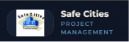
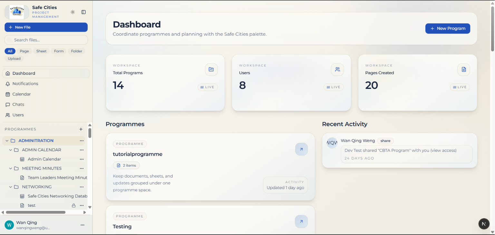
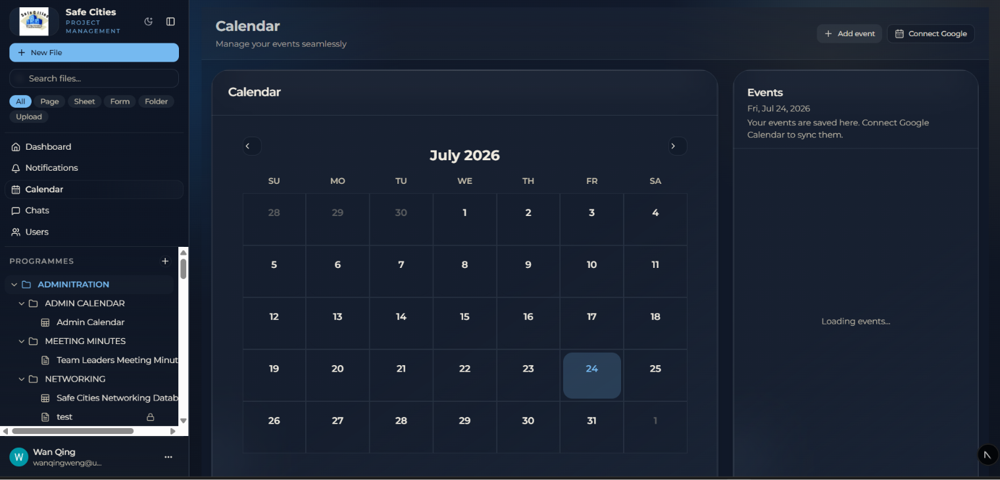
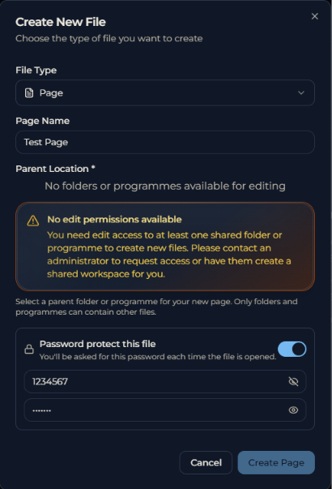

# Safe Cities Project Management Platform

<p align="center">
  
</p>

<p align="center">
  <strong>A modern collaborative workspace built for Safe Cities South Africa.</strong>
</p>

<p align="center">
Streamline programme management, document collaboration, user administration, and scheduling through a secure, intuitive, and centralized platform.
</p>

---

## 🌍 About Safe Cities South Africa

Safe Cities South Africa is a non-profit organization dedicated to creating safer communities across South Africa. This platform was developed as part of the **EDU Africa Software Engineering Internship** to help the organization manage programmes, documents, and collaboration more efficiently through a modern web application.

---

# 🎯 Project Overview

The Safe Cities Project Management Platform is an all-in-one workspace inspired by collaborative productivity tools like Notion while being tailored specifically to the operational needs of Safe Cities.

The platform centralizes programme management, secure document storage, team collaboration, user administration, and Google Calendar scheduling into one easy-to-use application.

## Key Objectives

- Streamline programme management through a centralized workspace
- Improve collaboration between team members
- Simplify content creation and document management
- Enhance security with authentication and role-based permissions
- Provide an intuitive and responsive user experience

---

# 🚀 Features

## 📁 Workspace & Programme Management

- Hierarchical programme and folder organization
- Create pages, folders, forms, and spreadsheets
- Rich text document editing
- File uploads and previews
- Search functionality
- Organized workspace navigation

## 🔐 Secure Authentication & Permissions

- Clerk Authentication
- Protected routes
- Secure user sessions
- Role-based permissions
- Password-protected documents

## 📅 Google Calendar Integration

- Connect a personal Google Calendar
- Synchronize existing calendar events
- Create new calendar events
- Delete events
- Manage schedules directly inside the application

## 👥 Collaboration

- User management
- Activity tracking
- Notifications
- Version history
- Restore previous document versions

## 🎨 Modern User Experience

- Responsive design
- Light and Dark Mode
- Modern dashboard
- Clean and intuitive interface
- Optimized navigation

---

# 📸 Screenshots

## Dashboard

The dashboard provides administrators with a centralized overview of programmes, workspace activity, and organizational resources.

<p align="center">
  
</p>

---

## Google Calendar Integration

Connect your Google Calendar to synchronize existing events and manage schedules directly inside the platform.

<p align="center">
  
</p>

---

## Password Protected Files

Secure confidential documents by requiring a password before files can be accessed.

<p align="center">
  
</p>

---

# 🛠 Technology Stack

## Frontend

- Next.js 15
- React
- TypeScript
- Tailwind CSS
- shadcn/ui

## Backend

- Next.js API Routes
- Node.js
- Drizzle ORM

## Database

- PostgreSQL
- Supabase

## Authentication

- Clerk

## APIs & Integrations

- Google Calendar API
- Google OAuth 2.0

## Deployment

- Vercel

---

# 🏗 Architecture

The application follows a modern full-stack architecture designed for scalability, security, and maintainability.

```text
                    User
                      │
                      ▼
             Next.js Frontend
                      │
      ┌───────────────┼────────────────┐
      │               │                │
      ▼               ▼                ▼
   Clerk        Google OAuth      API Routes
                                           │
                                           ▼
                                    Drizzle ORM
                                           │
                                           ▼
                              PostgreSQL (Supabase)
```

### Architecture Highlights

- Server-side rendering with Next.js App Router
- End-to-end TypeScript
- Component-based UI using shadcn/ui
- Secure authentication through Clerk
- PostgreSQL database managed with Drizzle ORM
- Google Calendar integration using OAuth 2.0

---

# 👥 User Personas

### Programme Coordinators

- Organize and oversee multiple programmes
- Manage permissions and users
- Coordinate team activities

### Team Members

- Create and edit documents
- Collaborate on shared projects
- Manage programme content

### Organization Administrators

- Manage users and permissions
- Monitor organizational activity
- Maintain programme structure

---

# 🚀 Getting Started

## Prerequisites

- Node.js 18 or later
- npm
- PostgreSQL database (Supabase recommended)

---

## Installation

### Clone the repository

```bash
git clone https://github.com/SafeCitiesGH/safe-cities-project-management.git

cd safe-cities-project-management
```

---

### Install dependencies

```bash
npm install
```

---

### Configure Environment Variables

Create a `.env.local` file in the project root.

```env
# Database
DATABASE_URL=

# Clerk
NEXT_PUBLIC_CLERK_PUBLISHABLE_KEY=
CLERK_SECRET_KEY=
CLERK_WEBHOOK_SIGNING_SECRET=

# Supabase
SUPABASE_URL=
SUPABASE_SERVICE_ROLE_KEY=
NEXT_PUBLIC_SUPABASE_URL=
NEXT_PUBLIC_SUPABASE_ANON_KEY=

# Google Calendar
GOOGLE_CLIENT_ID=
GOOGLE_CLIENT_SECRET=
GOOGLE_REDIRECT_URI=http://localhost:3000/api/google/callback
GOOGLE_CALENDAR_ID=primary
GOOGLE_REFRESH_TOKEN=
```

> Never commit your `.env.local` file or API keys to GitHub.

---

### Push the database schema

```bash
npx drizzle-kit push
```

---

### Run the development server

```bash
npm run dev
```

The application will be available at:

```
http://localhost:3000
```

---

# ✅ Current Features

| Feature | Status |
|----------|:------:|
| Secure Authentication | ✅ |
| Programme Management | ✅ |
| File Management | ✅ |
| Password Protected Files | ✅ |
| Google Calendar Integration | ✅ |
| User Management | ✅ |
| Notifications | ✅ |
| Version History | ✅ |
| Responsive Design | ✅ |
| Light & Dark Mode | ✅ |

---

# 🔮 Future Improvements

- AI-powered document assistance
- Email notifications
- Mobile application
- Advanced analytics dashboard
- Real-time collaborative editing
- Expanded administrative permissions

---

# 🤝 Contributing

This project was developed in collaboration with **Safe Cities South Africa** through the **EDU Africa Software Engineering Internship**.

Contributions are welcome through pull requests or by opening an issue to discuss proposed improvements.

---

# 📄 License

This project is licensed under the MIT License.

---

<p align="center">
Built with ❤️ using Next.js, TypeScript, PostgreSQL, Supabase, Clerk, and the Google Calendar API.
</p>
